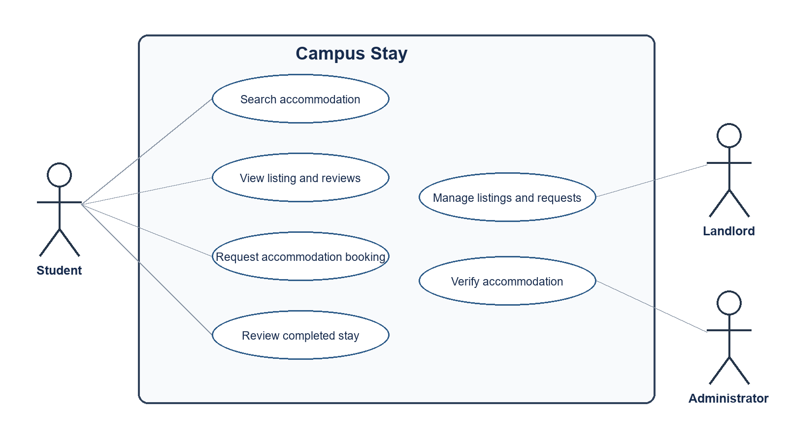
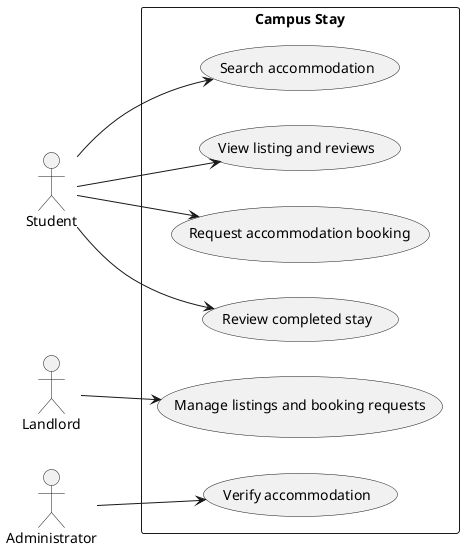
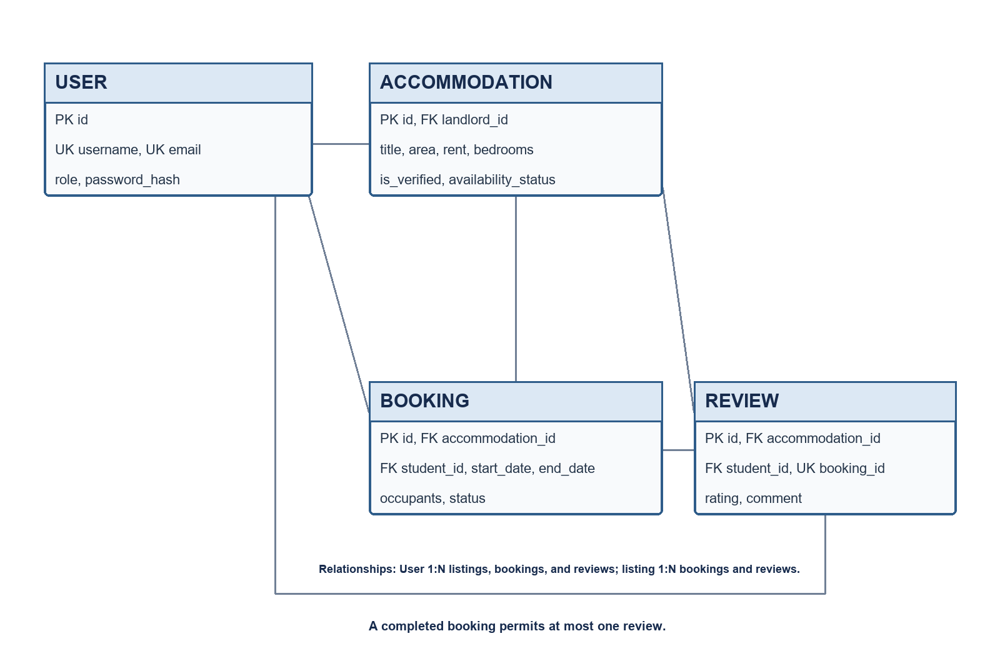
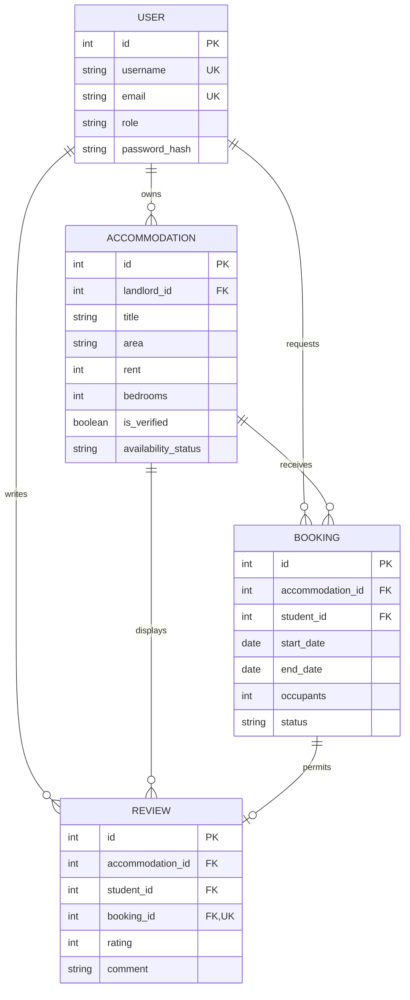
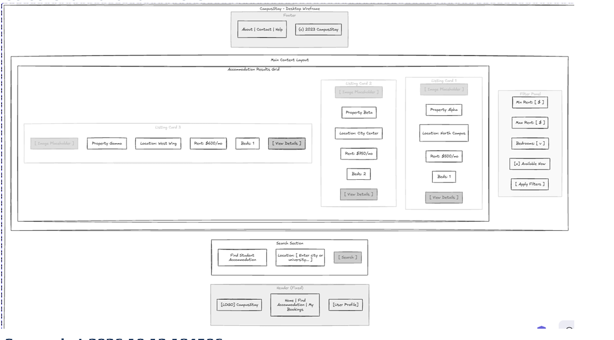
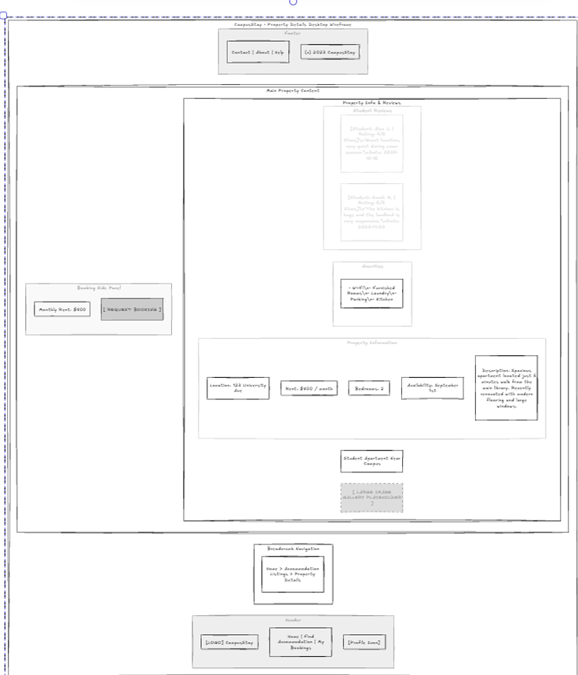
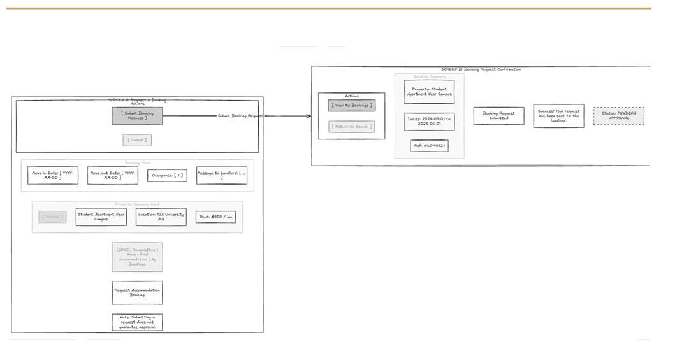

# Campus Stay — Testing Assessment

## Student and project

**Name:** Dinesh Kanhai  
**Student ID:** 816036619  
**Project:** Campus Stay — Student Accommodation  
**Repository:** [https://github.com/deen123123/comp3613_a2_816036619](https://github.com/deen123123/comp3613_a2_816036619)

## Project description

Campus Stay is a student accommodation marketplace for finding housing near the University of the West Indies. Students can search verified accommodation, compare listing information and reviews, and submit booking requests. Landlords manage their properties and respond to requests. An administrator verifies new accommodation before it is shown publicly.

The assessment tests the three student workflows represented in the supplied wireframes: search accommodation, view a listing and its reviews, and request accommodation booking.

## Use-case diagram

## Entity relationship diagram

## Application wireframes

### Search and filter results

### Listing details and reviews

### Booking request and confirmation

## Test plans and test implementation

The detailed test plan, test cases, execution instructions, and UAT forms are in [testing.md](testing.md). The implementation uses pytest and a temporary seeded SQLite database for automated coverage, plus an exported Postman collection for HTTP API checks.

- **Unit tests:** `tests/unit/` tests validators, accommodation filter normalization, and booking model rules in isolation.
- **Integration tests:** `tests/integration/test_api.py` checks the HTTP API and database-backed search behavior. `tests/test_workflows.py` exercises search, listing details, booking, role authorization, landlord decisions, reviews, and admin verification.
- **API tests:** [Campus-Stay-API.postman_collection.json](../postman/Campus-Stay-API.postman_collection.json) includes health, listing contract, location/rent, availability, and verification-visibility assertions.
- **Run automated tests:** `python -m pytest -v`

## Test reports and UAT status

Actual local pytest runs passed: 19 unit tests, 19 integration tests, and 38 total tests. Captured pytest output is included as rendered evidence images: [unit test output](evidence/unit-test-results.png) and [integration test output](evidence/integration-test-results.png). These are rendered from actual captured command output, not direct desktop screenshots. Import the Postman collection and run it against the locally initialized app, then attach the actual Postman Collection Runner screenshot and complete UAT sign-off after the student demonstration.

**Current status:** pytest is passing; Postman Collection Runner screenshot and UAT sign-off are pending. No test results are fabricated.
